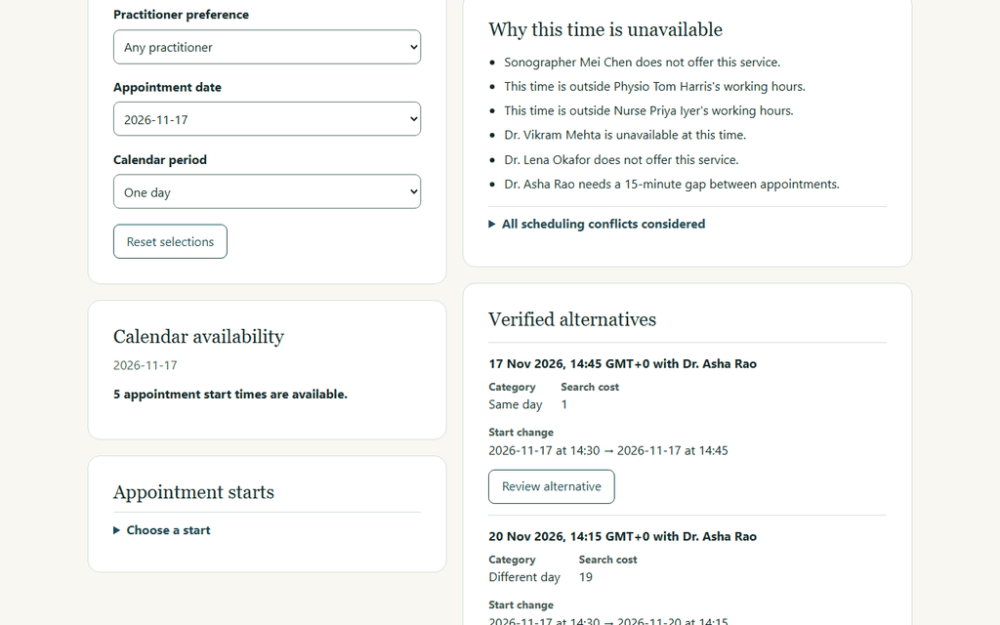

<p align="center">
  
</p>

<h1 align="center">WhyNot</h1>

<p align="center"><strong>Explain why an appointment is unavailable and show what would make it bookable.</strong></p>

<p align="center">
  <a href="https://kakumrkr.github.io/WhyNot/">Try the playground</a> ·
  <a href="#quick-start">Run locally</a> ·
  <a href="#use-the-engine">Use the engine</a>
</p>

An open-source TypeScript engine for appointment scheduling. A calendar can show an empty slot even when a practitioner is on leave, a room lacks the right equipment, or the previous booking needs a buffer. WhyNot evaluates those constraints together, returns the facts behind the decision, and rechecks suggested alternatives against the same rules.

## See a booking decision

Open the [Riverside minor-procedure scenario](https://kakumrkr.github.io/WhyNot/?scenarioId=H1). At **14:30**, Dr. Rao’s post-procedure buffer is still in effect and Dr. Mehta is unavailable. WhyNot verifies **14:45 with Dr. Rao** as an opening. Switch to **Staff** to inspect the candidate combinations and test a hypothetical policy change.

<p align="center">
  
</p>

## What it does

| Need                           | WhyNot returns                                                                                                                            |
| ------------------------------ | ----------------------------------------------------------------------------------------------------------------------------------------- |
| Explain a rejected appointment | A set of facts that accounts for every candidate. Patients get a privacy-filtered explanation. Staff can inspect the underlying evidence. |
| Find another time              | Rechecked alternatives and the search coverage, so you can see how far the engine looked.                                                 |
| Explain an empty calendar      | Groups of blocked starts, any shared cause, and a rechecked next opening when found.                                                      |
| Test a scheduling policy       | A before-and-after feasibility check for a concrete change, such as shorter notice or a different buffer.                                 |

The engine produces the same result for the same snapshot, request, and clock. It evaluates one appointment at one clinic. Search is bounded, and the demo uses fictional data.

## Quick start

Use **Node 24.22.3** and **pnpm 12.21.0**.

```sh
git clone https://github.com/Kakumrkr/WhyNot.git
cd WhyNot
pnpm install --frozen-lockfile
pnpm build
pnpm dev
```

Open [localhost:5173](http://127.0.0.1:5173/). This is the same static mode served by GitHub Pages. The engine runs in your browser with bundled fictional scenarios. You can also load the [Harbor example snapshot](examples/node/snapshot.json) under **Synthetic snapshot files**.

### Run with bookings and history

For persistent fictional bookings, start the local Fastify API and PostgreSQL using the [full-mode setup](docs/runbook.md#run-the-full-local-application). Confirm or cancel appointments, then open **History insights** in Staff view to inspect recorded outcomes and replay a policy change against historical requests. [History dashboard screenshot](docs/design/history-desktop.png)

## Use the engine

The [Node example](examples/node/README.md) packs the ESM libraries from your checkout and exercises them in a separate project. After installing and building, run:

```sh
pnpm exec node examples/node/verify-packages.mjs
```

The engine accepts a clinic snapshot, a booking request, and a clock as inputs. Project the result before passing it to patient-facing code.

```ts
import { evaluate, projectForAudience } from "@whynot/engine";

const staffResult = evaluate(snapshot, request, { now });
const patientResult = projectForAudience(staffResult, "patient", {
  requesterPatientId: request.patientId,
});
```

See the [integration guide](docs/integration.md) for data mapping, result semantics, and local package installation. The [engine architecture](docs/01-architecture.md) and [algorithm walkthrough](docs/writeup.md) show how candidates, facts, and explanations fit together.

## Contributing

Run `pnpm verify` before you open a pull request. See [Contributing](CONTRIBUTING.md) for test and reporting guidance, or start with the [runbook](docs/runbook.md) for development and deployment commands.

[MIT license](LICENSE) · [v1.0.0 release notes](docs/reviews/release-notes-v1.0.0.md)
